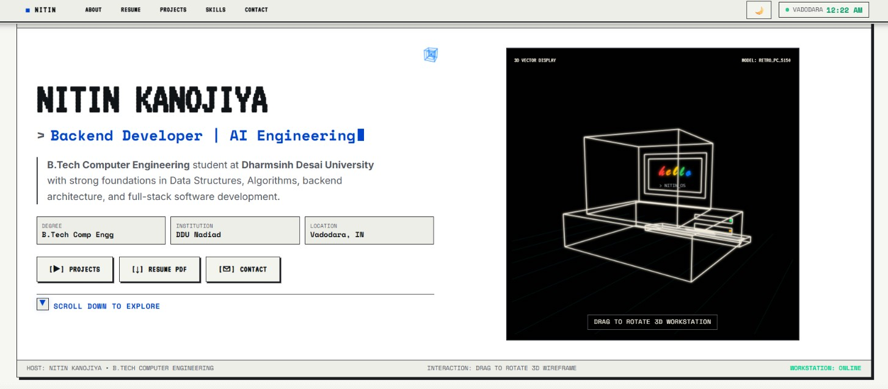

# 🖥️ Nitin Kanojiya | Software Engineer Portfolio

<div align="center">
  
</div>

## 🧭 Overview
An engineered, retro-futuristic developer portfolio built with modern web technologies (**Next.js 16**, **React 19**, **Three.js**, and **Tailwind CSS**). It blends nostalgic computing aesthetics—such as interactive 3D CRT workstations, a retro radar uplink, and vintage system window frames—with crisp engineering, fast performance, and an architectural drafting theme.

---

## ✨ Key Features

### 📡 Minimalist Retro Radar Uplink (`RetroRadar`)
- **Zero-Notification Silent Geolocation**: Detects visitor city and country silently in the background via IP lookups (`ipwho.is` / `ipapi.co`). Visitors **never** encounter annoying browser permission popups or location prompts.
- **Dual Vector Pins**: Real-time canvas radar scope displaying **`USER PIN [YOU]`** and **`HOST PIN [NITIN]`** (Vadodara, India) with dynamic distance calculation.
- **Message Airplane Flight Dispatch**: When a message or inquiry is submitted via the terminal, an animated vector airplane takes flight across the radar scope from the visitor pin to the host pin, complete with real-time delivery HUD alerts. Includes a manual `✈ TEST FLY` preview mode.
- **Optional Precise GPS**: A dedicated opt-in calibration button allows visitors to voluntarily calibrate exact coordinates via browser GPS whenever desired.

### 🖥️ 3D Retro Workstation (`RetroComputerCanvas`)
- Interactive 3D vintage computer terminal powered by **Three.js** and HTML5 Canvas.
- **Synchronized Keyboard-to-Monitor Typing**: Realistic animation that simulates typing `"hello"` from the physical keyboard directly onto the illuminated CRT monitor, complete with responsive key lighting.
- Mobile-optimized controls with smooth touch handling.

### 📑 Architectural Paper & Dual Theme System
- **Default Architectural Drafting White Mode**: Refined blueprint aesthetic with subtle drafting grids, monospaced typography, and technical borders.
- **Toggleable Retro Dark Mode**: Seamlessly switchable with instant persistence across sessions.
- **Retro OS Window Frames (`RetroWindow`)**: Windows 95 / Classic Mac styled window headers, minimize/expand controls, and terminal scanline effects.

### ⚡ Context Menu Component Quick-Loader (`ContextMenuLoader`)
- Custom right-click shortcut overlay providing rapid jumping and fast component previews across the portfolio.

### 💻 Interactive Developer Terminal & Contact Console
- Realistic code-editor contact form executing simulated TypeScript payloads.
- Live ticking **Vadodara Station Clock (IST - Asia/Kolkata)**.
- Quick copy controls and direct links to GitHub, LinkedIn, LeetCode, and Codeforces.

---

## 🛠️ Tech Stack

- **Framework:** [Next.js 16](https://nextjs.org/) (App Router)
- **Library:** [React 19](https://react.dev/)
- **Language:** [TypeScript 5](https://www.typescriptlang.org/)
- **Styling:** [Tailwind CSS v4](https://tailwindcss.com/)
- **3D Graphics & Canvas:** [Three.js](https://threejs.org/) & HTML5 2D Canvas
- **Motion & Interactions:** [Framer Motion](https://www.framer.com/motion/)
- **Icons:** [Lucide React](https://lucide.dev/) & [React Icons](https://react-icons.github.io/react-icons/)

---

## 🚀 Getting Started

1. **Clone the repository**
   ```bash
   git clone https://github.com/Nitin-kanojiya26/portfolio.git
   cd portfolio
   ```

2. **Install dependencies**
   ```bash
   npm install
   ```

3. **Run the development server**
   ```bash
   npm run dev
   ```

4. **Build for production**
   ```bash
   npm run build
   ```

5. **Start production server**
   ```bash
   npm start
   ```

Open [http://localhost:3000](http://localhost:3000) in your browser to view the application.

---

## 🌐 Live Deployment
🔗 **Live Site:** [https://nitin26-portfolio.vercel.app/](https://nitin26-portfolio.vercel.app/)

---

## 📄 License
This project is open-source and available under the [MIT License](LICENSE).

---
*Crafted with precision by [Nitin Kanojiya](https://github.com/Nitin-kanojiya26)*
